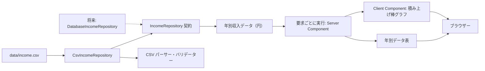

# 収入可視化アプリ 設計書

## 1. 概要

本書は [`要件定義書.md`](./要件定義書.md) に定めた収入可視化アプリの初回リリース設計を示す。Next.js App Routerを利用し、データ取得元をサーバー側のリポジトリ境界で抽象化する。初回リリースではリポジトリ内のCSVを検証して読み込み、年別収入を積み上げ棒グラフとデータ表で表示する。

## 2. 設計方針

- データ取得はサーバー側の `IncomeRepository` を介して行い、ファイルシステムやデータベースへのアクセスをブラウザーへ公開しない。
- 初回リリースではCSV実装を使用する。将来データベースへ移行するときは同じ取得契約を実装する別リポジトリへ差し替え、ページと表示コンポーネントは変更しない。
- 固定列のCSV解析には `csv-parse/sync` を使用し、列数や引用符を考慮した解析を独自実装しない。
- グラフ描画と対話操作だけをクライアントコンポーネントに分離する。
- 金額は計算・保持時に円の整数で扱い、表示時に万円へ換算する。
- CSVに問題がある場合は不正なデータを一部だけ表示せず、ファイル全体を拒否して利用者にエラーを示す。
- 初回リリースではAPI、データベース、利用者によるCSVアップロードを使用しない。

## 3. アーキテクチャ



### 3.1. データ処理

1. `/` のServer Componentが要求ごとに `IncomeRepository` から年別データを取得する。
2. 初回リリースの `CsvIncomeRepository` が要求ごとに `data/income.csv` を読み、CSVパーサーがヘッダー、列数、年、金額を検証する。
3. 検証済みデータを年ごとの型付きレコードに変換し、各年の合計を円で計算する。
4. ページは同じデータをグラフ用表示値とアクセス可能な表に渡す。
5. グラフ用コンポーネントが金額を万円に変換して軸、積み上げ棒、ツールチップ、合計ラベルを描画する。

### 3.2. コンポーネントと責務

| 対象 | 種別 | 責務 |
| --- | --- | --- |
| `src/app/page.tsx` | 要求ごとに実行するServer Component | リポジトリからのデータ取得、ページ見出し・説明、グラフと表の配置、読み込みエラー表示 |
| `lib/income/types.ts` | 共通型 | 年別収入データとCSVエラーの型を定義 |
| `lib/income/repositories/IncomeRepository.ts` | サーバー側契約 | `getAnnualIncomes(): Promise<AnnualIncome[]>` を定義 |
| `lib/income/repositories/CsvIncomeRepository.ts` | サーバー専用 | CSVの読み込みと解析を行い、インターフェースに沿って年別データを返す |
| `lib/income/repositories/createIncomeRepository.ts` | サーバー専用 | 現在使用するCSVリポジトリを生成する。将来の取得元切り替え箇所とする |
| `lib/income/parse-income-csv.ts` | サーバー専用 | CSV文字列の解析、入力検証、年別レコードの生成 |
| `lib/income/format.ts` | 表示用共通処理 | 円から万円への変換と小数点以下1桁の書式化 |
| `src/app/components/income/IncomeStackedBarChart.tsx` | Client Component | Rechartsによる棒グラフ、凡例、ツールチップ、年合計ラベル |
| `src/app/components/income/IncomeTable.tsx` | Server Component | グラフと同じ年別・項目別金額の表を表示 |

グラフ以外の見出しや説明はページで構成する。既存の共通ヘッダーはアプリ名とテーマ切り替えを担い、メインコンテンツには収入の推移が分かる見出しと短い説明を置く。

## 4. CSV仕様と検証

### 4.1. ファイル形式

- パス: `data/income.csv`
- 文字コード: UTF-8。BOMが付いている場合は先頭で除去する。
- ヘッダーは次の順序と完全一致を必須とする。

```csv
year,salary,dividends,other
```

- データ行は2016年から2025年まで各年1行、昇順で格納する。
- `salary`、`dividends`、`other` は税引後の円単位整数とする。桁区切りや小数、指数表記は使用しない。
- サンプル値はすべて架空の値とする。

### 4.2. 検証ルール

| 検証対象 | ルール | エラー表示 |
| --- | --- | --- |
| ヘッダー | 列名・順序が仕様と一致する。 | ヘッダーの形式が不正であることを示す。 |
| 行構造 | 各データ行が4列で、空行を含まない。 | CSVの行番号と列数または空行の問題を示す。 |
| 年 | 2016〜2025の各年が1回ずつ昇順で存在する。 | 不正な年、重複年、または不足年を示す。 |
| 収入額 | 3項目すべてが空でない0以上の10進整数で、JavaScriptの安全な整数範囲内である。 | CSVの行番号、列名、不正理由を示す。 |
| 全体 | 1か所でも不正ならCSV全体を拒否する。 | 不正な部分データは表示しない。 |

検証エラーは型付きエラーとして扱い、画面には日本語で要約と該当箇所を表示する。ファイルが存在しない、または読み取れない場合は一般的なデータエラーを表示し、詳細はサーバーログに記録する。例外を無視したり、空データに置き換えたりしない。

## 5. データモデルと計算

```ts
type AnnualIncome = {
    year: number;
    salary: number;
    dividends: number;
    other: number;
    total: number;
};
```

金額フィールドはすべて円単位の整数で、`total` は円単位で3項目を合計する。グラフ表示時に各金額を `10,000` で割り、`Intl.NumberFormat` などで小数点以下1桁に整形する。表示用の丸め値を再合計せず、合計額は元の円単位データから計算する。

## 6. 画面設計

### 6.1. ページ構成

1. 共通ヘッダーにアプリ名と既存のテーマ切り替えを表示する。
2. メイン領域に「年別収入の推移」などの見出しと、金額が税引後であることを含む短い説明を表示する。
3. グラフ領域に積み上げ棒グラフを表示する。
4. グラフの下に同じデータを示す年別表を表示する。

### 6.2. グラフ

- Rechartsの `ResponsiveContainer` と積み上げ対応の `BarChart` を使用する。
- 横軸は西暦、縦軸は万円とし、縦軸のラベルにも単位を明記する。
- 給与、配当金、その他の3系列を同じstack IDで積み上げる。
- 凡例は項目名を色とともに示し、色だけに意味を依存させない。
- ツールチップは各項目名と金額を万円・小数点以下1桁で示す。
- 年合計は各棒の上にラベルで表示する。ラベル位置は積み上げ合計に基づけ、その他の値が0円でも合計が読めるようにする。
- 狭い画面で10年分のラベルが読めるよう、グラフ領域を横スクロール可能にし、タッチ操作でも項目の値を確認できるようにする。

### 6.3. データ表

- セマンティックなHTMLテーブルを使用し、captionに「年別収入内訳（万円）」を示す。
- 列は「年」「給与」「配当金」「その他」「合計」とし、全値をグラフと同じ表示単位・精度で示す。
- 表は常時表示し、スクリーンリーダー利用者やグラフを判読しにくい利用者が全データを確認できるようにする。
- 狭い画面では表のコンテナーを横スクロール可能にする。

## 7. アクセシビリティとレスポンシブ対応

- 見出しレベルを適切にし、グラフと表を意味のあるsectionで構成する。
- Rechartsのアクセシビリティ用キーボード操作を有効にし、フォーカス状態を視認可能にする。
- グラフには内容を説明するアクセシブルな名前を付け、同じ値を表でも提供する。
- エラー領域には `role="alert"` を付けて支援技術に通知する。
- スマートフォン、タブレット、デスクトップで余白・文字サイズ・グラフ高さを調整する。
- 凡例や系列の識別は色に加えてテキストで提供し、十分なコントラストを保つ。

## 8. エラー状態

| 状況 | 表示・動作 |
| --- | --- |
| CSVの検証エラー | グラフと表を表示せず、CSVの行・列または年と原因を示すエラーを表示する。 |
| CSVの読み込みエラー | グラフと表を表示せず、サンプルデータを読み込めないことを示す。詳細はサーバーログに残す。 |
| 正常 | 検証済みの全10年分のみをグラフと表に表示する。 |

利用者向けの再試行ボタンは設けない。実行環境のCSVを修正した場合は次の要求で読み直す。本番のリポジトリ内CSVを変更する場合は再デプロイが必要となる。

## 9. テスト設計

- CSVパーサーの正常系: 10年分、0円を含む有効な値、合計値。
- CSVパーサーの異常系: ヘッダー不一致、列数不正、空欄、小数、文字列、負数、重複年、不足年、範囲外の年。
- 書式化: 円から万円への変換、端数の小数点以下1桁表示、合計は円単位で先に計算されること。
- ページ: 見出し・説明・グラフ・表の表示、読み込みエラー時に不正データを表示しないこと。
- グラフ: 3系列の積み上げ、凡例、項目別ツールチップ、年合計ラベルが表示されること。
- アクセシビリティ: 表のcaption・列見出し、グラフのアクセシブルな名前、キーボード操作を検証する。

## 10. 対象外・移行上の注意

- 利用者によるCSVアップロード、編集、年の絞り込みは初回リリースの対象外。
- 初回リリースではサーバーAPIやデータベースによる収入データの永続化は行わない。
- 既存のメッセージ用 `/api/message`、SQLite実装、関連する型定義・テストは、収入可視化の実装と同時に削除する。既存の生成済みSQLiteデータファイルは削除対象に含めない。
- `recharts` はアプリの依存関係として追加し、Next.jsのビルドと本番環境での描画を確認する。
- `csv-parse` はサーバー側のCSV解析用依存関係として追加し、クライアントバンドルには含めない。
- `/` は `export const dynamic = 'force-dynamic'` を指定した動的レンダリングとし、データリポジトリを毎回呼び出す。Next.jsの静的生成・データキャッシュで取得結果が固定されないようにする。
- `data/income.csv` は本番デプロイ成果物に含める。リポジトリ内CSVの変更はデプロイ後の要求から反映されるが、リポジトリの変更を本番へ反映するには再デプロイが必要となる。
- 将来のデータベース製品・スキーマ・接続方式はこの設計では選定せず、導入時に別途決定する。初回リリースではCSVリポジトリのみを実装する。

## 11. 設計決定ログ

| ID | 決定内容 | 決定日 |
| --- | --- | --- |
| D-01 | 旧メッセージAPI、SQLite実装、関連型・テストを収入可視化の実装時に削除する。既存の生成済みSQLiteデータファイルは削除しない。 | 2026-10-19 |
| D-02 | 初回はCSVをデータリポジトリ経由で要求ごとに読み込む。将来DBへ移行する際は同じ契約を実装するリポジトリに差し替え、DB製品とスキーマは導入時に決める。本番のリポジトリ内CSV変更は再デプロイで反映する。 | 2026-10-19 |
